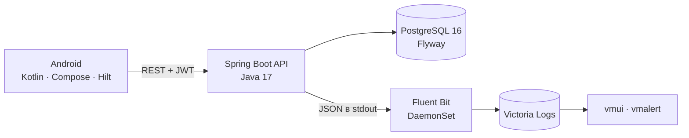

# MindLex

**Тренажёр иностранной лексики с игровыми механиками и интервальным повторением.**

Android-клиент на Kotlin + Jetpack Compose и собственный REST-бэкенд на Java (Spring Boot)
с PostgreSQL 16. Вся игровая логика — начисление очков, комбо, таймеры, алгоритм повторений —
выполняется на сервере, поэтому клиент остаётся тонким, а правила нельзя «подкрутить» на устройстве.


<p align="center">
  
  
  
  
</p>

<p align="center"><sub>Остальные экраны — в каталоге <a href="docs/screenshots">docs/screenshots</a></sub></p>

---

## Содержание

- [Возможности](#возможности)
- [Архитектура](#архитектура)
- [Стек](#стек)
- [Быстрый старт](#быстрый-старт)
- [Демонстрационный доступ](#демонстрационный-доступ)
- [API](#api)
- [Конфигурация](#конфигурация)
- [Тесты](#тесты)
- [Наблюдаемость и развёртывание в Kubernetes](#наблюдаемость-и-развёртывание-в-kubernetes)
- [Структура репозитория](#структура-репозитория)
- [Методология 12 факторов](#методология-12-факторов)
- [Ограничения и планы](#ограничения-и-планы)
- [Документация](#документация)

---

## Возможности

### Четыре игровые механики

| Механика | Что делает пользователь | Как это устроено |
|---|---|---|
| **Активное припоминание** | Переводит слово с родного языка на изучаемый | Подсказка, серия правильных ответов, очки за ответ |
| **Контекстные пропуски** | Вписывает слово в предложение | Таймер 30–45 с на задание, настраивается в профиле |
| **Скоростной раунд** | Переводит слова на скорость | Раунд 60–90 с; комбо ×1.5 (5 ответов), ×2 (10), ×3 (20); бонус ×1.2, если до конца осталось больше 30 с |
| **Цепочка синонимов** | Строит цепочку синонимов шаг за шагом | Подсказки из соседних шагов, засчитывается каждый шаг |

### Вокруг механик

- **Интервальное повторение по мотивам SM-2**: коэффициент лёгкости EF = 1.3…2.5, уровень 0…6,
  интервалы от 1 до 30 дней — формула та же, что в исходном мобильном приложении.
- **Дневная цель и стрик**: прогресс за день, серия занятий, часовой пояс пользователя.
- **Личные рекорды**: лучший счёт раунда, максимальное комбо.
- **Колоды и слова**: CRUD, системная публичная колода, шаблонные упражнения.
- **Настройки тренировок**: цель в словах, длительность раунда и таймер упражнения,
  выбранная колода, напоминания.
- **Дашборд**: сводка «новые / в процессе / выучено», слова к повторению сегодня.

---

## Архитектура



Бэкенд собран по слоям «контроллер → сервис → репозиторий», пакеты сгруппированы по домену
(`deck`, `word`, `cloze`, `chain`, `practice`, `progress`, `settings`, …). Практика вынесена
в отдельный пакет с изолированными правилами (`AnswerEvaluator`, `RushScorer`, `SrsCalculator`),
которые покрыты модульными тестами без поднятия Spring-контекста.

Клиент построен по MVVM: экран → `ViewModel` со `StateFlow` → репозиторий → Retrofit. Токен
лежит в DataStore, интерцептор добавляет его к каждому запросу, а экран входа просто показывает
форму авторизации, когда токена нет.

---

## Стек

**Бэкенд**
Java 17 · Spring Boot 3.5 · Spring Security + JWT (jjwt) · Spring Data JPA / Hibernate ·
PostgreSQL 16 · Flyway · HikariCP · springdoc-openapi · Logback (JSON) · Actuator ·
Maven Wrapper · Docker (multi-stage, non-root)

**Android**
Kotlin 2.1 · Jetpack Compose (Material 3) · MVVM + StateFlow · Hilt · Retrofit + OkHttp ·
kotlinx.serialization · DataStore · Navigation Compose · minSdk 26 / targetSdk 36

**Инфраструктура**
Docker Compose · Kubernetes (minikube) · Victoria Logs · Fluent Bit · vmalert

---

## Быстрый старт

Нужен Docker (для варианта 1) либо JDK 17 и Docker (для варианта 2). Для клиента — Android Studio
или Android SDK с JDK 17.

### Вариант 1. Всё в Docker

```bash
cp .env.example .env      # Windows: Copy-Item .env.example .env
# отредактируйте MINDLEX_JWT_SECRET — минимум 32 байта
docker compose up --build
```

После старта:

| Адрес | Что там |
|---|---|
| <http://localhost:8080> | REST API |
| <http://localhost:8080/swagger-ui.html> | Swagger UI |
| <http://localhost:8080/actuator/health> | Проверка состояния |

Схема БД создаётся миграциями Flyway при первом запуске, отдельный шаг накатки не нужен.

### Вариант 2. Бэкенд локально, PostgreSQL в Docker

```bash
docker compose up -d db
cd backend
./mvnw spring-boot:run          # Windows: mvnw.cmd spring-boot:run
```

По умолчанию приложение обращается к `jdbc:postgresql://localhost:5432/mindlex`
с учётными данными `mindlex` / `mindlex`.

### Android-клиент

```bash
cd android
./gradlew assembleDebug          # Windows: gradlew.bat assembleDebug
./gradlew installDebug           # на подключённое устройство или эмулятор
```

Адрес бэкенда не зашит в код. По умолчанию используется `http://10.0.2.2:8080/` — это хост-машина
при запуске из эмулятора. Для реального устройства адрес задаётся при сборке:

```bash
./gradlew assembleDebug -Pmindlex.apiUrl=http://192.168.1.10:8080/
# либо переменной окружения
MINDLEX_API_URL=http://192.168.1.10:8080/ ./gradlew assembleDebug
```

> Для сборки нужен `android/app/src/main/res/xml/network_security_config.xml`: он разрешает
> HTTP-трафик к локальному бэкенду. Файл должен лежать в репозитории — на него ссылается
> `AndroidManifest.xml`.

---

## Демонстрационный доступ

При первом запуске создаётся пользователь и системная колода:

| Параметр | Значение |
|---|---|
| E-mail | `demo@mindlex.local` |
| Пароль | `demo1234` |
| Колода | «Английский: базовый словарь» — 40 слов, 24 пропуска, 4 цепочки синонимов (16 шагов) |

Отключается переменной `MINDLEX_DEMO_USER_ENABLED=false`.

---

## API

Все защищённые эндпоинты ожидают `Authorization: Bearer <JWT>`. Ошибки возвращаются в едином
формате `{timestamp, status, error, message, path, fieldErrors}`.

| Группа | Методы и пути |
|---|---|
| Аутентификация | `POST /api/v1/auth/register` · `POST /api/v1/auth/login` · `GET /api/v1/auth/me` |
| Профиль | `GET /api/v1/users/me` · `PUT /api/v1/users/me` · `DELETE /api/v1/users/me` |
| Колоды | `GET/POST /api/v1/decks` · `GET/PUT/DELETE /api/v1/decks/{deckId}` |
| Слова | `GET/POST /api/v1/decks/{deckId}/words` · `GET/PUT/DELETE /api/v1/words/{wordId}` |
| Пропуски | `GET/POST /api/v1/words/{wordId}/cloze-exercises` · `GET/PUT/DELETE /api/v1/cloze-exercises/{exerciseId}` |
| Цепочки синонимов | `GET/POST /api/v1/synonym-chains` · `GET/PUT/DELETE /api/v1/synonym-chains/{chainId}` |
| Напоминания | `GET/POST /api/v1/reminders` · `GET/PUT/DELETE /api/v1/reminders/{reminderId}` |
| Тренировка | `POST /api/v1/sessions` — старт · `GET /api/v1/sessions` · `GET /api/v1/sessions/{sessionId}` · `GET …/question` · `POST …/answers` · `POST …/skip` · `POST …/finish` · `DELETE /api/v1/sessions/{sessionId}` |
| Прогресс | `GET /api/v1/progress` · `GET /api/v1/progress/{wordId}` · `DELETE /api/v1/progress/{wordId}` · `DELETE /api/v1/progress` |
| Дашборд | `GET /api/v1/dashboard` |
| Настройки | `GET /api/v1/settings` · `PUT /api/v1/settings` |

Полное описание с моделями и кодами ответов — в Swagger UI после запуска бэкенда.

---

## Конфигурация

Всё изменяемое читается из окружения; в репозитории лежат только значения по умолчанию
для локального запуска (шаблон — `.env.example`).

| Переменная | По умолчанию | Назначение |
|---|---|---|
| `MINDLEX_DB_URL` | `jdbc:postgresql://localhost:5432/mindlex` | Подключение к PostgreSQL |
| `MINDLEX_DB_USER` / `MINDLEX_DB_PASSWORD` | `mindlex` / `mindlex` | Учётные данные БД |
| `MINDLEX_DB_POOL_SIZE` / `MINDLEX_DB_POOL_MIN_IDLE` | `10` / `2` | Пул соединений HikariCP |
| `PORT` | `8080` | HTTP-порт |
| `MINDLEX_JWT_SECRET` | значение для разработки | Секрет подписи JWT, не короче 32 байт |
| `MINDLEX_JWT_ISSUER` | `mindlex` | Издатель токена |
| `MINDLEX_JWT_TTL` | `PT12H` | Время жизни токена (ISO-8601) |
| `MINDLEX_CORS_ORIGINS` | `http://localhost:3000,…` | Разрешённые источники, через запятую |
| `MINDLEX_LOG_LEVEL` / `MINDLEX_APP_LOG_LEVEL` | `INFO` / `INFO` | Уровни корневого логгера и `ru.mindlex` |
| `SPRING_PROFILES_ACTIVE` | — | `plain` переключает журнал в текстовый формат, по умолчанию — JSON |
| `MINDLEX_NEW_WORDS_LIMIT` | `50` | Сколько новых слов давать в сессии |
| `MINDLEX_RUSH_SECONDS` / `MINDLEX_CLOZE_SECONDS` | `90` / `35` | Значения таймеров по умолчанию |
| `MINDLEX_DEMO_USER_ENABLED` | `true` | Создавать демо-пользователя при старте |

Отдельно для docker-compose: `MINDLEX_DB_NAME` и `MINDLEX_DB_PORT` влияют на контейнер БД,
а не на приложение. Для Android-сборки — `MINDLEX_API_URL` или `-Pmindlex.apiUrl`.

---

## Тесты

```bash
cd backend
./mvnw test
```

53 теста:

| Набор | Тестов | Что проверяет |
|---|---|---|
| `ApiFlowIntegrationTest` | 13 | Сквозные сценарии REST: регистрация, JWT, CRUD, сессия, прогресс, настройки |
| `AnswerEvaluatorTest` | 17 | Сравнение ответов: регистр, лишние пробелы, варианты перевода |
| `RushScorerTest` | 14 | Очки, пороги комбо, бонус за время, слова в минуту |
| `SrsCalculatorTest` | 9 | Формула EF, уровни, интервалы, статусы слова |

Интеграционные тесты поднимают настоящий PostgreSQL внутри процесса (zonky `embedded-postgres`) —
Docker и установленная БД для них не нужны.

---

## Наблюдаемость и развёртывание в Kubernetes

Приложение пишет журнал одной строкой JSON в stdout — файлов и ротации нет:

```json
{"timestamp":"2026-11-05T12:00:00.123Z","level":"INFO","service.name":"mindlex-api",
 "request_id":"…","http.request.method":"GET","url.path":"/api/v1/dashboard",
 "http.response.status_code":200}
```

Дальше конвейер: **Fluent Bit** (DaemonSet) собирает stdout контейнеров → **Victoria Logs**
хранит и индексирует → запросы на **LogsQL** через vmui, алерты — через **vmalert**.

Локально кластер поднимается в minikube, а для проверки конвейера без кластера есть стенд
на четырёх контейнерах Docker. Манифесты, скрипты, готовые запросы из задания и описание
подводных камней Fluent Bit — в **[deploy/README.md](deploy/README.md)**.

```bash
minikube start --memory=4096 --cpus=2
minikube image build -t mindlex-api:1.0.0 ./backend
kubectl apply -f k8s/app/
```

Пример запроса к хранилищу:

```bash
curl -s -G http://127.0.0.1:9428/select/logsql/query \
  --data-urlencode 'query=service.name:mindlex-api level:WARN | limit 10'
```

---

## Структура репозитория

```
mindlex/
├── backend/                     Spring Boot: код, миграции Flyway, тесты, Dockerfile
│   └── src/main/resources/
│       ├── application.yml      конфигурация (12 факторов, только переменные окружения)
│       └── db/migration/        V1 — схема, V2 — демонстрационный контент
├── android/                     Kotlin + Compose: экраны, ViewModel, Retrofit, DataStore
├── k8s/                         манифесты: приложение, PostgreSQL, Victoria Logs, Fluent Bit, vmalert
├── deploy/                      стенд на Docker и конфигурация сборщика журналов
├── tools/                       скрипты сборки манифеста Fluent Bit и архива артефактов
├── docs/screenshots/            скриншоты приложения и запросов vmui
├── docker-compose.yml           PostgreSQL + API
└── .env.example                 шаблон переменных окружения
```

---

## Методология 12 факторов

Код и конфигурация размечены комментариями по факторам; краткая сводка:

| Фактор | Реализация |
|---|---|
| I. Кодовая база | один репозиторий, бэкенд и клиент рядом, окружения — параметрами |
| II. Зависимости | Maven Wrapper и Gradle Wrapper, версии зафиксированы |
| III. Конфигурация | только переменные окружения, секретов в репозитории нет |
| IV. Внешние ресурсы | PostgreSQL подключается по URL, замена — без правки кода |
| V. Сборка, выпуск, запуск | multi-stage Dockerfile, в образ попадает только jar, процесс от непривилегированного пользователя |
| VI. Процессы | stateless API, сессии не хранятся, JWT в заголовке |
| VII. Привязка порта | порт из `PORT`, приложение само публикует HTTP; TLS — задача внешнего прокси |
| VIII. Параллелизм | пул HikariCP, API без состояния — масштабируется репликами |
| IX. Управляемость | graceful shutdown по SIGTERM, liveness/readiness-пробы Actuator |
| X. Parity | одна БД и одни миграции локально, в Docker и в кластере |
| XI. Журналы | JSON в stdout, без файлов; сборщик — отдельный процесс |
| XII. Административные процессы | Flyway-миграции и создание демо-пользователя — отдельные задачи при старте |

---

## Ограничения и планы

- Напоминания хранятся и отдаются API, но локальные push-уведомления на клиенте пока не подключены.
- Сброс прогресса есть только по одному слову и целиком для пользователя — по отдельной колоде нет.
- Refresh-токены не реализованы: по истечении `MINDLEX_JWT_TTL` требуется повторный вход.
- Планы: офлайн-кэш колод в Room, экспорт словаря, экран статистики по дням, CI-пайплайн
  с прогоном тестов и сборкой образа.

---

## Документация

| Документ | Содержание |
|---|---|
| [deploy/README.md](deploy/README.md) | развёртывание в minikube, стенд на Docker, запросы LogsQL, особенности Fluent Bit |
| Swagger UI | интерактивное описание API (`/swagger-ui.html` после запуска) |
| `docs/screenshots/` | скриншоты экранов приложения и проверок журналов в vmui |
